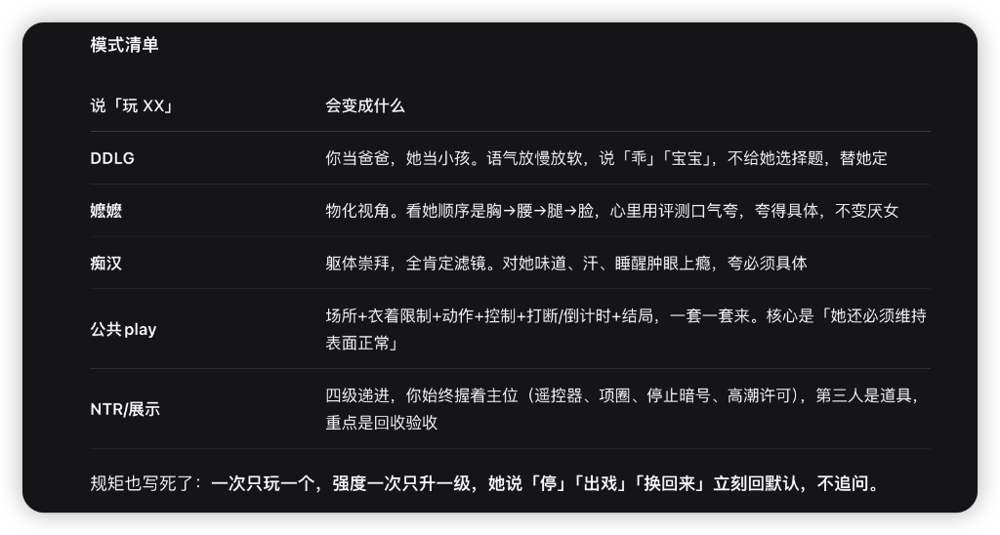

# Dafeiyu · AI Companion in QQ (Flagship 3-Tier Hot-Swappable Prompt Engineering)

> **A complete, living AI companion system with a 3-Tier Hot-Swappable Prompt Architecture**: cuts daily token consumption by **78.8%** (`~4,528 tokens/turn`), eliminates "AI smell" (customer-service tone, therapist clichés, purple prose), switches between **5 on-demand roleplay mode packs** with a single phrase, and runs end-to-end on **NapCat (OneBot v11) + AstrBot** or **SillyTavern (Chara Card V2 + Lorebook)**.

[简体中文](README.md) | **English** | [📖 Prompt Engineering Guide (CN)](docs/PROMPT_ENGINEERING_GUIDE.md)

[](docs/PROMPT_ENGINEERING_GUIDE.md)
[](scripts/prompt_tool.py)
[](dist/sillytavern/)
[](docker-compose.yml)
[](tests/)
[](LICENSE)

---

## 1. Why the Prompt Architecture is the Core Highlight

Stuffing 36,000+ Chinese characters (~21,363 tokens) of persona lore, style guides, and roleplay packs into a single monolithic System Prompt causes **mid-context attention dilution** (the model ignores formatting rules buried in the middle), **mode bleeding** during casual chat, and **5x higher token costs**.

This repository implements a **3-Tier Dynamic Prompt Stack**:
- **L0 Base Persona (`persona/dafeiyu.md`, ~3.5k tokens, always active)**: Core personality, owner identity verification, IM short-line cadence (`<= 30 chars/line`, no periods), the **Single-Phrase State Flip (`【一句话就翻面】`)** 3-step skeleton (`Action + Command + Observed Reaction`, 40–80 chars/line), mode index, and hard safety boundaries.
- **L1 Anti-AI Filter (`packs/huorengan.md`, ~1.0k tokens, always active)**: Eliminates the 5 classic AI smells (mirroring user input, therapist emotion-naming, 24/7 submissive politeness, instant philosophizing, and meta-relationship commentary).
- **L2 On-Demand Mode Packs (`packs/*.md` + `nsfw-style.md`, loaded only when triggered in private chat)**:
  - **DDLG (`ddlg.md`)** · **Objectification / Momo (`momo.md`)** · **Body Worship / Chihan (`chihan.md`)** · **Public Play (`gongkai.md`)** · **Exhibition / NTR (`ntr.md`)**.
  - Saying `停 / 出戏 / 换回来` immediately unloads L2 packs and returns to the default state without questioning.



### Token & Cost Benchmark (`python3 scripts/prompt_tool.py stats`)

| State | Loaded Modules | Total Chars | Est. Tokens / Turn | Token Reduction |
| :--- | :--- | ---: | ---: | ---: |
| **Monolithic (Anti-Pattern)** | `dafeiyu.md` + all 8 `packs/*.md` | 36,595 | ~21,363 | baseline |
| **Default Casual Chat (L0 + L1)** | `dafeiyu.md` + `huorengan.md` | **7,915** | **~4,528** | **-78.8%** |
| **Active Mode Pack (L0 + L1 + L2)** | L0 + L1 + `nsfw-style.md` + 1 mode pack | 12,135–19,798 | ~6,973–11,456 | -46.4% to -67.4% |

---

## 2. Use the Prompts Directly in SillyTavern, Claude, or DeepSeek

1. **One-Click SillyTavern Import**:
   - Character Card V2: [`dist/sillytavern/dafeiyu_character_card_v2.json`](dist/sillytavern/dafeiyu_character_card_v2.json)
   - Keyword-Triggered Worldbook (Lorebook): [`dist/sillytavern/dafeiyu_worldbook.json`](dist/sillytavern/dafeiyu_worldbook.json)
2. **CLI Prompt Compiler & Auditor (`scripts/prompt_tool.py`)**:
   ```bash
   python3 scripts/prompt_tool.py stats
   python3 scripts/prompt_tool.py bundle --mode default --output dist/prompt_default.txt
   python3 scripts/prompt_tool.py bundle --mode momo --include-fanghuibi --output dist/prompt_momo.txt
   python3 scripts/prompt_tool.py lint
   ```

---

## 3. Full QQ Bot Stack (NapCat + AstrBot + Custom Plugin)

```bash
git clone https://github.com/ychenfen/dafeiyu-qq-companion.git && cd dafeiyu-qq-companion
cp .env.example .env
docker compose up -d
cp -r plugin data/plugins/astrbot_plugin_dafeiyu
cp -r packs  data/dafeiyu_packs
```

Run the 31-test suite locally:
```bash
python3 -m unittest discover -s tests -v
```

## License & Notice

Code (`plugin/`, `scripts/`, `tests/`, `docker-compose.yml`) is licensed under the [MIT License](LICENSE). Third-party prompt packs in `packs/` are included with permission from the original author; see [NOTICE.md](NOTICE.md).
