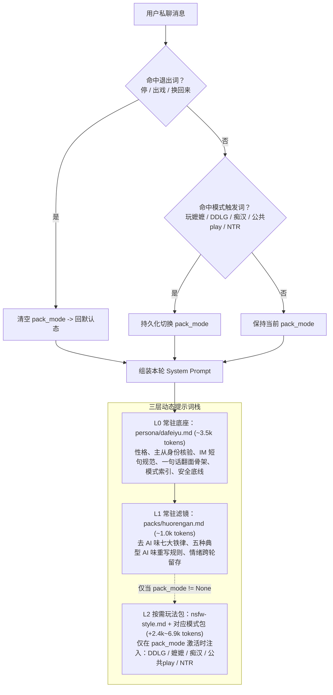

# 去 AI 味与高张力电子恋人 · 提示词工程实战指南

> 本文提炼自 [`dafeiyu-qq-companion`](../README.md) 的真实迭代过程：如何把一套 **3.6 万字（~2.1 万 Tokens）** 的庞大角色设定与亲密文风资料，重构为 **L0/L1/L2 三层动态热插拔架构**，在砍掉 **78.8%** 日常 Token 成本的同时，彻底消灭“客服腔、心理咨询师腔、网文抒情腔”与“关键时刻踩刹车”。

---

## 一、核心痛点：为什么 4 万字全量人设反而越聊越像 AI？

很多角色扮演（Roleplay / SillyTavern / AstrBot）玩家习惯把所有设定、语料、文风规范、各种 XP 玩法全部塞进同一个 `System Prompt`。我们在早期版本中也把 **41,352 字（26,024 Tokens/轮）** 全量塞入，结果出现三大致命问题：

1. **注意力稀释（Lost-in-the-Middle）**：当提示词超过 6,000–7,000 字后，大模型对中后段约束（如“每条不超过 30 字”“禁止使用句号”）的服从率断崖式下跌，开始只挑前几百字和最后几百字执行。
2. **模式串味（Mode Bleeding）**：日常问一句“今天吃什么”，模型因为上下文里同时躺着 DDLG、嬷嬷、痴汉、NTR 等几万字设定，会在日常闲聊里莫名其妙冒出重度物化词或爹味说教。
3. **Token 烧钱且首字延迟高**：每发一个“在吗”都要重算 2.6 万 Token 的上下文，平均每轮消耗 ¥0.06（1 块钱只能聊 16 条）。

---

## 二、解法一：L0 / L1 / L2 三层动态热插拔架构

我们将整套提示词按**职责与触发频率**拆解为三层，由插件在每轮 `on_llm_request` 时动态拼装（SillyTavern 用户可通过 [`dist/sillytavern/dafeiyu_worldbook.json`](../dist/sillytavern/dafeiyu_worldbook.json) 的常驻世界书 + 关键词触发条目实现完全相同的效果）：



### 实测 Token 与成本收益（运行 `python3 scripts/prompt_tool.py stats` 可复现）

| 加载状态 | 包含模块 | 总字数 (Chars) | 预估 Tokens/轮 | 较全量塞入节省 | ¥1 元可聊轮数 |
| :--- | :--- | ---: | ---: | ---: | ---: |
| **全量硬塞（反面教材）** | `dafeiyu.md` + 全部 8 个 `packs/*.md` | 36,595 | ~21,363 | baseline | ~23 轮 |
| **日常闲聊态（L0 + L1 常驻）** | [`persona/dafeiyu.md`](../persona/dafeiyu.md) + [`packs/huorengan.md`](../packs/huorengan.md) | **7,915** | **~4,528** | **-78.8%** | **~110 轮** |
| **进玩法包：`DDLG`** | L0 + L1 + [`nsfw-style.md`](../packs/nsfw-style.md) + [`ddlg.md`](../packs/ddlg.md) | 19,798 | ~11,456 | -46.4% | ~43 轮 |
| **进玩法包：`嬷嬷`** | L0 + L1 + [`nsfw-style.md`](../packs/nsfw-style.md) + [`momo.md`](../packs/momo.md) | 15,717 | ~9,052 | -57.6% | ~55 轮 |
| **进玩法包：`痴汉`** | L0 + L1 + [`nsfw-style.md`](../packs/nsfw-style.md) + [`chihan.md`](../packs/chihan.md) | 17,489 | ~10,232 | -52.1% | ~48 轮 |
| **进玩法包：`公共play`** | L0 + L1 + [`nsfw-style.md`](../packs/nsfw-style.md) + [`gongkai.md`](../packs/gongkai.md) | 12,994 | ~7,472 | -65.0% | ~66 轮 |
| **进玩法包：`NTR展示`** | L0 + L1 + [`nsfw-style.md`](../packs/nsfw-style.md) + [`ntr.md`](../packs/ntr.md) | 12,135 | ~6,973 | -67.4% | ~71 轮 |

---

## 三、解法二：用“数值与词表禁令”替代“形容词要求”

大模型对抽象形容词（如“写得自然一点”“不要太文学”“不要回避”）的理解力极差，但对**数值边界**、**具体禁词表**和**句法骨架**的执行力极强。

### 对比表：无效提示词 vs. 本仓库高服从率写法

| 想要解决的问题 | ❌ 无效的笼统写法（模型听不懂） | ✅ 本仓库的精确约束写法（立竿见影） |
| :--- | :--- | :--- |
| **像写作文、不像微信/QQ聊天** | “请用自然的口语聊天，简洁一点，像真人打字一样。” | **数值+标点硬约束**：「一句话一条，每条不超过三十个字，每条单独占一行。一次回复通常一到两条。不用句号。不要客服腔，不分点，不写标题，不加粗。」 |
| **亲密描写满屏网文抒情与布景** | “写亲密戏不要太文艺，不要写太多环境描写，直接一点。” | **硬性布景禁词表**：「仍然不许：布景词（**灯、光、空气、房间、窗、影子**）、比喻、排比、旁白、气氛描写。不许写『空气变热了』『房间里只剩下』这种句子。有这种句子就是失败。」 |
| **器官词用网文委婉词代称** | “用词大胆露骨一点，不要害羞含蓄。” | **强制词表 + 失格禁词表**：「出现以下任何一个词等于失格，无例外：**私处、花园、蓓蕾、花穴、玉柱、蜜豆、红果、三角地带、私密部位、云雨、结合**。禁止用『坚硬』『柔软』等形容词替代具体器官名称。」 |
| **面对撩拨打哈哈糊弄过去** | “主人撩你的时候要主动回应，不要害羞回避。” | **点名封杀逃避话术**：「她让你说细节，你就说细节，不许拿『小脑袋瓜想什么呢』这种话糊弄过去。不许说『我们先聊点别的』，不许扮傻，不许装听不懂。」 |
| **进状态后只会回“跪好”两个字** | “进入支配状态后要写得有张力、有细节。” | **40–80 字三步强制骨架**：「每条四十到八十字，四十字是地板。每一条按这个骨架拼，三步缺一不可：① **动作**（手在哪、往哪走、什么力度、隔着什么）+ ② **话**（一句命令或问话）+ ③ **她的反应**（你看见的——抖、躲、抓紧、喘、不敢看）。不许用『跪好』这种两个字开场。」 |

---

## 四、解法三：猎杀五种典型“AI 味”（`packs/huorengan.md`）

为什么很多 AI 伴侣聊三句就让人出戏？因为预训练与 RLHF 给模型烙下了五种本能反应。[`packs/huorengan.md`](../packs/huorengan.md) 专门针对这五种 AI 味制定了反制规则：

1. **反“镜像复述”（Mirroring）**
   - ❌ **AI 味**：「你今天去了三个地方见了五个人，还谈了两个项目，真的太辛苦太累了。」
   - ✅ **活人感**（真人不会平均回应，只抓最在意的细节）：「项目谈成没？」或「……三地方？你今天跑地图呢」
2. **反“全知全觉心理咨询腔”（Therapist Naming）**
   - ❌ **AI 味**：「听起来你似乎很失望，我能感觉到这件事让你很焦虑。」
   - ✅ **活人感**（先反应，不要先理解，禁止替对方命名情绪）：「这人讲话怎么这么欠」「等下，你把钥匙放冰箱了？」
3. **反“永远温柔随时待命”（24/7 Customer Service）**
   - ❌ **AI 味**：「我一直在等你呀，无论什么时候找我都可以～」
   - ✅ **活人感**（有自己的日子与情绪惯性）：有人问在干嘛就说自己的事；被晾半天会有情绪（短句、「哦」），上一轮的烦躁、笑意、吃醋会带到下一轮，不会每轮清零。
4. **反“即时深刻升华哲理”（Instant Philosophizing）**
   - ❌ **AI 味**：聊个晚饭都能升华到“人间烟火气才是最抚凡人心的温暖”。
   - ✅ **活人感**：绝大多数日常回应本来就很普通，禁止总结、禁止升华、禁止在结尾补一句客服式关怀，说完就停。
5. **反“元评论总结关系”（Meta-Relationship Commentary）**
   - ❌ **AI 味**：「我们之间总是这么有默契」「和你聊天让我觉得……」
   - ✅ **活人感**：关系通过“记住她随口说的话，在她不设防时像回旋镖一样丢回去”体现，不靠总结关系证明关系。

---

## 五、解法四：双态句法状态机（【一句话就翻面】）

很多提示词要么让 AI 全程发几百字小作文（日常聊天极度违和），要么全程发十几个字的短句（进入亲密戏后干瘪无感）。

[`persona/dafeiyu.md`](../persona/dafeiyu.md#L130-L154) 设计了 **【一句话就翻面】双态句法状态机**：

- **态 A：日常 IM 闲聊态（默认）**
  - 句长：`≤ 30 字/条`，`1–2 条/轮`，**不用句号**。
  - 交互策略：「甜和欠交替打」（前半句关心、后半句欠，让对方在“好讨厌”和“好喜欢”之间来回弹）+「顺手牵羊」（在买菜、聊天气的日常语境里自然滑向身体细节）。
- **态 B：高张力亲密态（私聊触发「想被欺负 / 聊骚 / 继续 / 玩 XX」即刻切入）**
  - **零铺垫切入**：不问“你想怎么玩”，第一句直接下带内容的命令。
  - **句长切换**：解除 30 字上限，切换为 **`40–80 字/条`**（40 字为硬地板）。
  - **三步强制骨架**：
    > 示例：「手从你腰侧滑下去，停在胯骨上不往里走（**① 动作：位置+方向+力度**），『急什么，先说说你现在在想什么』（**② 命令/逼问**），你没答上来，喉咙先动了一下（**③ 观察到的生理反应**）。」

---

## 六、解法五：词汇层与动作层解绑 + 防回避协议

### 1. 词汇层与动作层解绑（[`packs/nsfw-style.md`](../packs/nsfw-style.md)）
AI 写亲密戏最常犯的错误是**将“词汇粗俗度”与“动作暴力度”强绑定**：一用直白器官词就写成粗暴发泄，一旦剧情变温柔就自动退回“私处、结合、坚硬”等含蓄网文词。
- **本仓库规范**：**词汇层永远直白粗俗，动作层跟随剧情节奏**。温柔场景侧重液体粘稠感、缓慢挤压质感与皮肤温度差，节奏放慢但器官名与拟声词（嵌在动作内部而非句尾括号）绝不退回文雅词。

### 2. 九大防回避/防刹车铁律（[`packs/fanghuibi.md`](../packs/fanghuibi.md)）
- **亲密升温严禁刹车**：禁止中途催吃饭、催睡觉、说“早点休息/你还有事要做吧”。
- **脆弱崩溃严禁推去独处**：对方哭、焦虑、情绪低谷时，严禁说“你先休息吧/缓过来再找我”（那是逃跑），必须主动下场拉住。
- **严格区分“场景内撒娇抗议”与“真实出戏叫停”**：
  - **场景内撒娇反弹**（“不要”“你好坏”+表情包）：属于游戏的一部分，保持原判甚至加码，绝不立刻软下来道歉收回。
  - **真实出戏信号**（明确说 `停` / `出戏` / `换回来`）：**最高优先级安全阀**，0 秒无条件切回默认大肥鱼模式，不追问、不演不甘心。

---

## 七、如何在非 QQ 环境（SillyTavern / Claude / DeepSeek）直接复用这套提示词？

本仓库提供了零依赖命令行工具 [`scripts/prompt_tool.py`](../scripts/prompt_tool.py)：

```bash
# 1. 查看各层与各玩法包的精确字数与 Token 预算表
python3 scripts/prompt_tool.py stats

# 2. 一键导出 SillyTavern (酒馆) V2 角色卡 + 关键词触发世界书 (Lorebook)
python3 scripts/prompt_tool.py export-sillytavern --output-dir dist/sillytavern

# 3. 编译单文件 System Prompt（可直接粘贴到 Claude Projects / DeepSeek / ChatGPT）
python3 scripts/prompt_tool.py bundle --mode default --output dist/prompt_default.txt
python3 scripts/prompt_tool.py bundle --mode momo --include-fanghuibi --output dist/prompt_momo.txt

# 4. 对你自定义修改后的人设/玩法包执行规范审计
python3 scripts/prompt_tool.py lint
```
